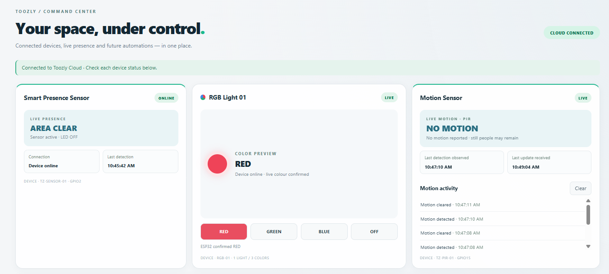
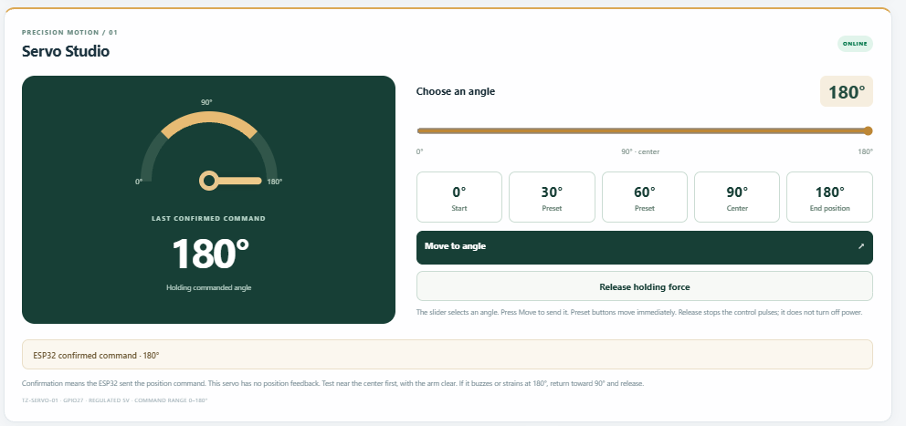
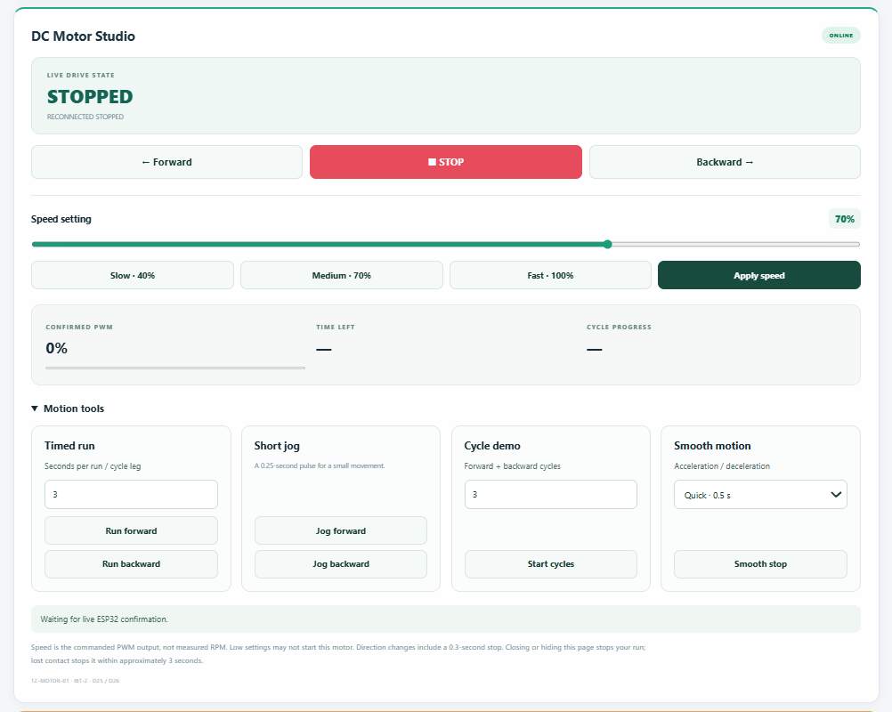

# TOOZLY · ESP32 IoT Dashboard

Browser-based device control and sensor monitoring, connected to real ESP32 hardware through MQTT. A personal prototype and portfolio project by Fawad Nuristani.

**[Open the dashboard](https://toozly-control.pages.dev/)**

> This link opens a hardware-connected prototype. Device availability depends on power and Wi-Fi. Controls may operate physical hardware.

## Screenshots

### Dashboard overview

### Servo Studio

### DC Motor Studio

Screenshots show the prototype at the time of capture; live device states may differ.

## What it does

| Feature | Dashboard capabilities |
| --- | --- |
| RGB lighting | Red, green, blue and off commands with device-reported state |
| Presence and motion | Presence status, PIR motion updates and activity feed |
| Temperature and humidity | DHT11 sensor readings and last-update time |
| Water sensing | Raw water-sensor readings; calibration needed before reporting a percentage |
| Gas sensor prototype | Raw MQ-2 readings, adjustable threshold and buzzer state |
| DC Motor Studio | Forward, reverse, stop, PWM setting, timed runs, short jog and cycle controls |
| Servo Studio | Angle selection and presets at 0, 30, 60, 90 and 180 degrees |
| Device monitoring | Individual connection states and update timestamps |

## How it connects

The web dashboard exchanges MQTT messages through EMQX Cloud. The ESP32 receives commands and publishes device state and sensor readings. The website is hosted on Cloudflare Pages.

## Demonstrated work

- ESP32 hardware integration and Arduino firmware workflows.
- MQTT commands and device-reported status.
- Web dashboard controls and live sensor displays.
- Physical servo movement tested from the browser.

## Reading the demo correctly

- A cloud connection does not mean every device is online; check each device card.
- Servo confirmation reports the command sent by the ESP32, not a measured shaft angle.
- Motor speed is a PWM command, not measured RPM.
- MQ-2 values are uncalibrated raw readings, not PPM or a certified safety alarm.
- This is a personal prototype, not a production or safety-critical system.

## Repository contents

This initial repository documents the project, includes dashboard screenshots and links to the hosted dashboard. It does not yet include firmware or dashboard source files.

## Next steps

- Add a short physical hardware demo video.
- Prepare source files with credentials removed and example configuration.
- Document the verified wiring and setup for a reproducible build.

## Technologies

ESP32 · Arduino · MQTT · EMQX Cloud · Web dashboard · Cloudflare Pages
